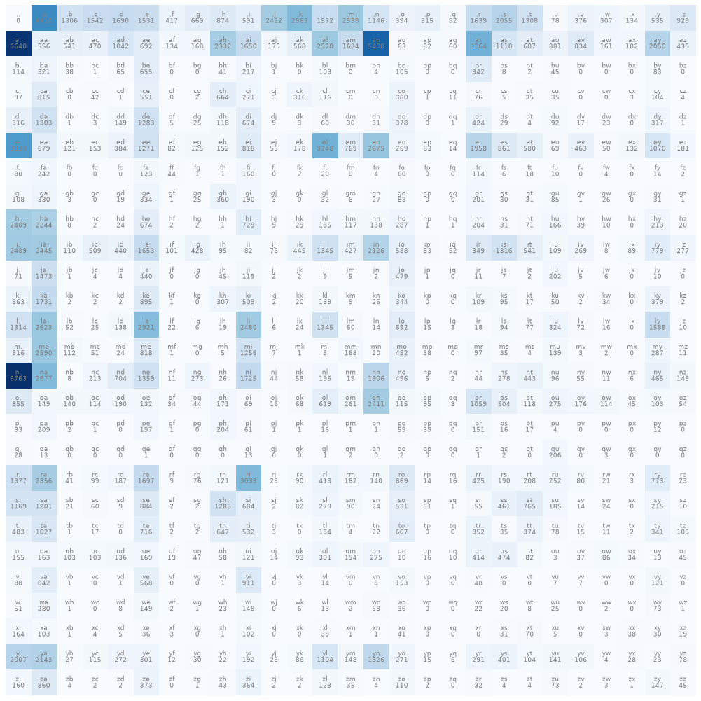
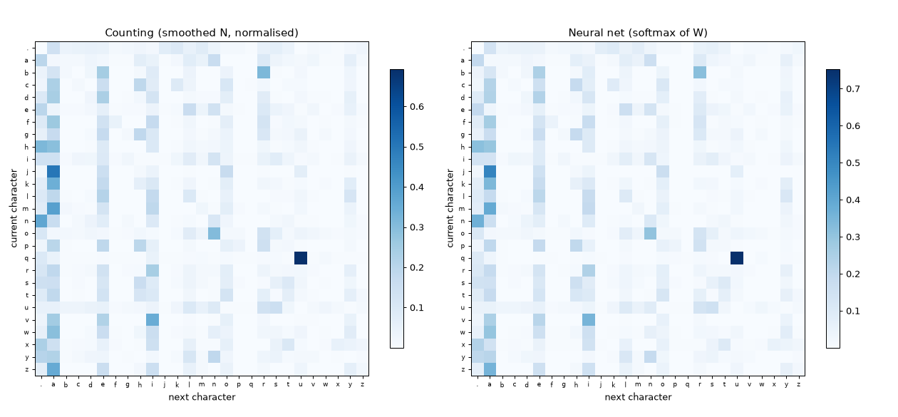
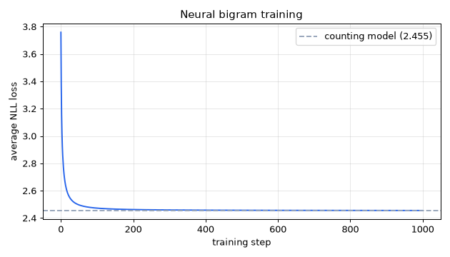

# Bigram Language Model

A character-level **bigram language model** trained on ~32,000 first names, built two ways in PyTorch:

1. **Counting.** Tally every pair of adjacent characters into a 27×27 table, smooth it, and normalise each row into probabilities.
2. **Neural net.** One linear layer (one-hot input → 27 logits → softmax), trained by gradient descent on negative log-likelihood.

Both end up with almost the same table, which is the point. The neural version is the same idea that bigger language models scale up.

### ▶ [Play with it: **The Name Machine**](https://p-niranjan-web.github.io/bigram-language-model/)

A small, jargon-free web page where anyone can make up names, check how name-like a word is, and look at what letter the model expects next.



---

## Results

| model | average NLL on the training names | what that means |
|---|---|---|
| uniform guess (1/27) | 3.2958 | knows nothing |
| neural net, random init | 3.7590 | worse than knowing nothing |
| **counting** (add-1 smoothing) | **2.4546** | best a bigram can do here |
| **neural net** (1,000 steps, lr 50) | **2.4554** | converges to the counting table |

Correlation between the two probability tables: **0.999273**.





Sample names (counting model, seed `2147483647`):

```
cexze
momasurailezitynn
konimittain
llayn
ka
da
staiyaubrtthrigotai
moliellavo
ke
teda
```

They look name-ish but strange, because the model only ever sees one character of context.

## Project layout

```
bigram-language-model/
├── bigram/                 # the model, as a small Python package
│   ├── vocab.py            #   load names, map characters ↔ integers ('.' = start/end)
│   ├── counting.py         #   approach 1: count table + smoothing
│   ├── neural.py           #   approach 2: one-layer net + gradient descent
│   └── sampling.py         #   generate names, compute NLL
├── scripts/train.py        # trains both, prints results, exports web/model.js
├── notebooks/
│   └── makemore_bigram.ipynb   # the original step-by-step notebook
├── web/                    # The Name Machine (static, no build step)
│   ├── index.html
│   ├── app.js
│   ├── style.css
│   └── model.js            # generated: both probability tables + the names list
├── data/names.txt          # 32k names, one per line
├── assets/                 # charts used in this README
└── tests/test_bigram.py
```

## Run it yourself

```bash
git clone https://github.com/p-niranjan-web/bigram-language-model.git
cd bigram-language-model
python -m venv .venv
# Windows: .venv\Scripts\activate     macOS/Linux: source .venv/bin/activate
pip install -r requirements.txt

python scripts/train.py --plots   # train both models, regenerate web/model.js and assets/
pytest                            # run the tests
```

Open `web/index.html` in a browser to use the Name Machine locally. It needs no server, since the
model ships as a plain script.

Useful flags for `train.py`: `--steps`, `--lr`, and `--reg` (weight regularisation, the gradient-descent
counterpart of count smoothing).

## How it works

**Data.** Each name is padded with a boundary token, so `emma` becomes `. e m m a .`, which gives
5 training pairs: `(.,e) (e,m) (m,m) (m,a) (a,.)`. The vocabulary is `.` plus `a`–`z`, 27 tokens in all.

**Counting.** `N[i, j]` is how often token `j` follows token `i`. Adding 1 to every cell (Laplace
smoothing) keeps unseen pairs from getting probability 0, which would make the loss infinite. Dividing
each row by its sum gives `P`.

**Neural net.** Input `x` is one-hot, so `x @ W` simply selects row `W[i]`. Those are the logits.
`exp(logits)` plays the role of counts, and normalising them (softmax) gives probabilities.
Minimising cross-entropy pushes `softmax(W[i])` toward the empirical row `N[i] / N[i].sum()`, so
`exp(W)` learns to approximate `N`.

**Loss.** Average negative log-likelihood, `−(1/M) Σ log P[xᵢ, yᵢ]`. Lower is better. A model
that guessed uniformly would score `log 27 ≈ 3.30`.

**Sampling.** Start at `.`, draw the next token from `P[current]`, and repeat until `.` comes up again.
The web page adds a *wildness* slider (temperature): each probability is raised to `1/T` and the row
is renormalised.

## Credits

Follows Andrej Karpathy's [makemore](https://github.com/karpathy/makemore) lecture series
(Neural Networks: Zero to Hero). The `names.txt` dataset comes from that repo (MIT).

## License

MIT
